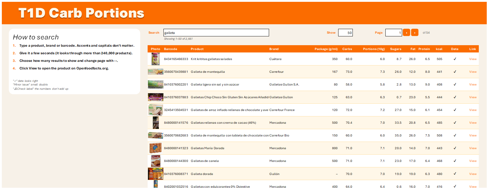
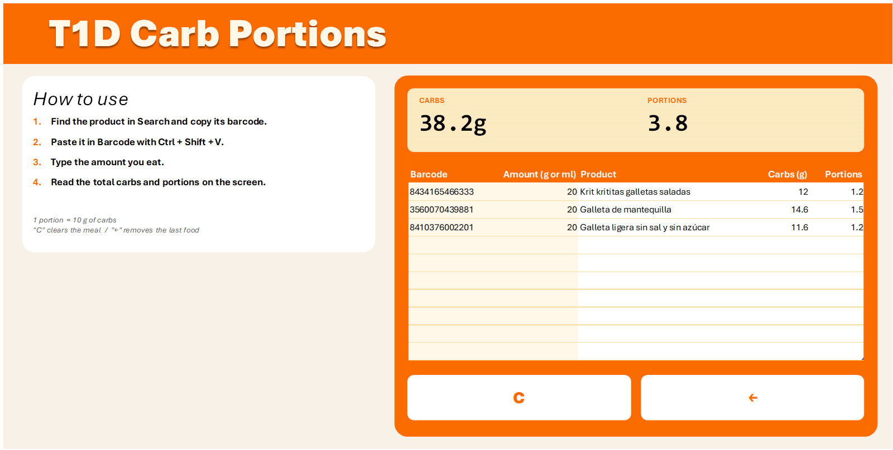
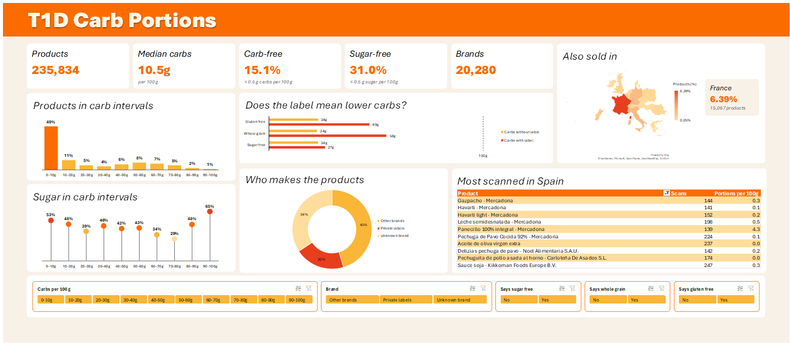
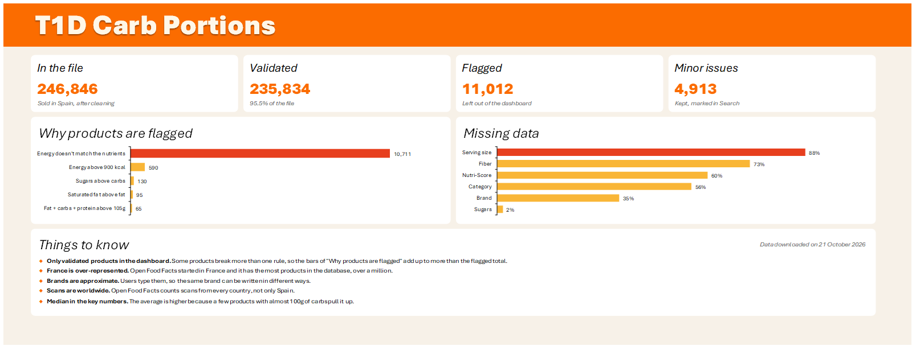

  

  An Excel workbook to count carbs in food sold in Spain, built on the Open Food Facts database.

People with type 1 diabetes count the carbs of everything they eat. In Spain they count in portions, one portion is 10g of carbs. Labels give carbs per 100g, so there is always some maths to do, and many products are hard to find.

I built this workbook to make that easier: find any product, add up a meal, and see what the Spanish market looks like in terms of carbs. It is also my first full data project, so I cleaned, checked and documented everything as if someone else had to maintain it.

 

## What's inside

### Search

Type a product, a brand or a barcode and you get every match with its photo, nutrients per 100g, portions and a link to its page on Open Food Facts.

Behind the search box there are 246,846 products. Names and brands are stored a second time without accents or capitals, so "maria", "María" and "MARIA" find the same products. Results are sorted so the useful ones come first: products with reliable data, then products where all your words are in the name (not only in the brand), then the most scanned ones. They come in pages of 20, 50 or 100, because every photo is downloaded from the internet and showing thousands at once took minutes.

Every product also says how much you can trust its numbers: ✓ when they look right, *Minor issue* when Open Food Facts has small doubts, and &#9888;&#xFE0E; *Check label* when they don't add up. Flagged products are not hidden, because someone looking for their own barcode should still find it.

### Calculator

Paste the barcode of each food in a meal and type how much you eat. The screen on top shows the total carbs and portions as you type, and each row shows the product name, so you can check it's the right one.

It looks up each barcode in the product table, takes its carbs per 100g and works out the carbs of the amount you eat. Portions are calculated from the total carbs of the meal, not by adding up rounded numbers. The beige cells are the ones you fill in and the white ones are filled by Excel. **C** clears the meal and **←** removes the last food.

It stops at portions on purpose: insulin doses depend on each person and are not something a spreadsheet should guess.

### Analysis

A dashboard of the Spanish market, built only on the 235,834 products whose numbers add up.

Five key numbers on top: products, median carbs, products with almost no carbs, products with almost no sugar, and brands. Below them, six charts: how products spread across carb intervals, how much of those carbs is sugar, whether package labels mean fewer carbs, who makes the products, where else they are sold, and the ten most scanned products sold only in Spain.

The filters at the bottom change everything at once, with one exception: a filter doesn't change the chart that is already split by it. If you pick private labels, the brands chart keeps all the brands and greys out the rest, so you still see how big your choice is. Small touches like that are explained in [docs/decisions.md](docs/decisions.md).

### Quality

How far the data can be trusted. It shows how many products were flagged and which rule each one broke, what information is missing most often (serving size is missing in 88% of products), and the limits to keep in mind when reading the dashboard.

 

## What surprised me

**Half of the products have almost no carbs.** 49% have less than 10g per 100g. The median product has 10.5g, but the average is 24.2g, because a few products with almost 100g pull it up.

**"Sugar free" doesn't mean sugar free.** Only 46% of the products that say it on the package have 0.5g of sugar or less. Most of them mean "no added sugar".

**"Whole grain" products have more carbs, not less.** 58g per 100g on average, against 24g for products that don't say it. Same with "gluten free", 49g against 24g. A healthy label is NOT a low carb label.

**Not all carbs are sugar.** Carbs are mostly sugar and starch, and the mix changes a lot. In products with few carbs, like dairy, more than half of the carbs is sugar. In bread, pasta and rice (70 to 80g of carbs) only 29% is sugar, the rest is starch. In sweets (90 to 100g) sugar is back up to 65%.

**4.5% of the products are flagged.** Flagged means their numbers don't add up, like more than 900 kcal per 100g or more sugar than carbs. The most common reason is energy written in kJ instead of kcal, about four times too high.

**The data has an accent.** Open Food Facts started in France and has over a million French products, so France looks like the country that shares the most products with Spain.

 

## How it's built

**Clean data** → Power Query reads the full Open Food Facts export, keeps the products sold in Spain and fixes types, text and impossible values. Products with numbers that don't add up are flagged, not deleted.

**Every decision written down** → [docs/decisions.md](docs/decisions.md) has 26 decisions, each with its context, what was chosen and what was discarded.

**Documented workbook** → [docs/workbook_structure.md](docs/workbook_structure.md) explains every sheet and [docs/workbook_formulas.md](docs/workbook_formulas.md) every formula and measure.

**Data model** → the dashboard runs on Power Pivot: DAX columns and measures, slicers, and CUBEVALUE for the cards and the map. The clean table is never changed for a chart.

**Modern Excel** → Search is one dynamic array formula (LET, FILTER, SORTBY, MMULT, IMAGE). The heavy parts are calculated once, in named formulas, so searching 246,846 products stays fast.

**Macros only where formulas can't** → paging, the calculator keys, the zoom of each sheet and two chart details. All the code is in [vba/](vba), commented.

**Ready for new data** → replace the export and press Refresh All. Lists like supermarket brands and countries are tables, so they can grow without touching a formula.

**Versioned** → every step was committed with a short message, so the history shows how the project grew.

 

## Using the workbook

Open it with macros enabled and start from **Home**: each card takes you to a sheet. To load newer data, download the CSV export from [Open Food Facts](https://world.openfoodfacts.org/data), put it in `data/raw/` next to the workbook and use **Data > Refresh All**. It takes a few minutes.

 

## Words used in the workbook

**Portion** → 10g of carbs, the unit used in Spain.

**Carb interval** → products grouped by carbs per 100g, in steps of 10g: 0 to 10g, 10 to 20g and so on.

**Carb free** → 0.5g of carbs or less per 100g.

**Sugar free** → 0.5g of sugar or less per 100g, the limit the EU uses for "sugar free" claims.

**Says sugar free** → the package says it. It filters by the label, not by the real sugar. The same goes for *Says whole grain* and *Says gluten free*.

**Validated** → products whose nutrients add up. The dashboard only uses these.

**Flagged** → products whose numbers don't add up, for example more than 900 kcal per 100g. Search shows them with &#9888;&#xFE0E; *Check label*.

**Minor issue** → the numbers add up, but Open Food Facts has small doubts about them.

**Private labels** → supermarket brands, like Hacendado, Carrefour or Dia. *Other brands* are the rest, and *Unknown brand* means the product has no brand in the data.

**Scans** → how many people scanned the product with the Open Food Facts app, in any country.

**Also sold in** → share of the products sold in Spain that are also sold in each country.

 

Data from [Open Food Facts](https://world.openfoodfacts.org), available under the [Open Database License](https://opendatacommons.org/licenses/odbl/1-0/).

> [!WARNING]
> This workbook counts carbs and portions only. It doesn't calculate insulin doses, which depend on each person and should be agreed with a doctor.